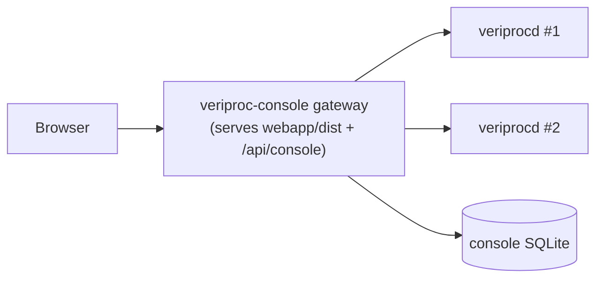

# 10. Operator Web Console

The operator console is a **separate gateway process** (`veriproc-console`) that polls one
or more upstream `veriprocd` instances and serves a browser UI. It is independent of any
single daemon: one console can front several deployments.



## 10.1 What it provides

- A dashboard aggregating tasks, runs, and station health across configured instances.
- Browsing of run trees and file previews within allow-listed filesystem roots.
- Its own authentication (`viewer`/`operator` tokens), independent of upstream daemons.
- A small SQLite database for console tokens, audit, and UI state.

## 10.2 Running it

Build the frontend first (see [Installation §4.3](04-installation-build.md)), then:

```bash
./bin/veriproc-console --config sandbox-console/console.yaml
# open http://127.0.0.1:8090/ and sign in with a configured token
```

### Flags

| Flag | Env | Default | Meaning |
|------|-----|---------|---------|
| `--config <path>` | `VERIPROC_CONSOLE_CONFIG` | — (required) | Console YAML config. |
| `--http-addr <addr>` | — | from config | Override `http.bind_addr`. |
| `--webapp-dir <path>` | `VERIPROC_CONSOLE_WEBAPP` | from config | Override the built-frontend directory. |
| `--log-level <level>` | — | `info` | trace\|debug\|info\|warn\|error. |

## 10.3 Configuration

```yaml
schema_version: veriproc.console/v1

http:
  bind_addr: 127.0.0.1:8090

ui:
  refresh_interval: 5s            # dashboard auto-refresh cadence
  visible_slot_count: 15          # number of live slots shown
  completed_visibility_timeout: 30s   # how long completed items linger
  default_stats_since: 24h        # default stats window
  upstream_summary_timeout: 30s   # timeout fetching an instance summary
  preview_max_bytes: 1048576      # max bytes served by file preview
  station_runs_page_size: 50      # default page size for station activity view

db:
  dsn: file:sandbox-console/console.db   # console-scoped SQLite (schema auto-created)

auth:
  # Preferred: authenticate against the same access profile the daemons use.
  # When profile_path is set it is the sole credential source; the inline
  # tokens below no longer authenticate anyone.
  profile_path: /shared/veriproc/access.profile
  # Admit credential-less reads of /api/console/* as a read-only session so
  # the dashboard opens without a login. Independent of each daemon's own
  # allow_unauthenticated_readers flag.
  allow_anonymous_browsing: true
  # Legacy (only when profile_path is unset): console-local identities.
  # Plaintext only for local use. The gateway stores SHA-256 hashes at
  # registration time; plaintext is never persisted.
  tokens:
    - { subject: viewer-demo,   role: viewer,   token: sandbox-viewer-token }
    - { subject: operator-demo, role: operator, token: sandbox-operator-token }

webapp_dir: webapp/dist            # built Preact bundle

instances:
  - id: sandbox1
    title: Sandbox1
    base_url: http://127.0.0.1:8080      # upstream veriprocd
    token: ""                            # bearer token for upstream (if it requires auth)
    upstream_timeout_ms: 10000
    working_root_base: sandbox1/data/working-roots
    allowed_roots:                       # filesystem containment for browsing/preview
      - sandbox1/data/working-roots
      - sandbox1/rolling-archives
```

### Config reference

| Section | Key | Meaning |
|---------|-----|---------|
| `http` | `bind_addr` | Address the console UI/API listens on. |
| `ui` | `refresh_interval` | How often the dashboard refreshes. |
| `ui` | `visible_slot_count` | Number of live processing slots displayed. |
| `ui` | `completed_visibility_timeout` | How long completed items stay visible. |
| `ui` | `default_stats_since` | Default statistics lookback window. |
| `ui` | `upstream_summary_timeout` | Per-instance summary fetch timeout. |
| `ui` | `preview_max_bytes` | Maximum file-preview size. |
| `ui` | `station_runs_page_size` | Default page size for the station activity view's run table (default: 50). |
| `db` | `dsn` | Console SQLite location (`file:<path>`). |
| `auth.profile_path` | — | Shared access-profile file; when set it replaces `auth.tokens` as the credential source. |
| `auth.allow_anonymous_browsing` | — | Admit credential-less reads of the console API as a read-only session. Independent of the daemons' `allow_unauthenticated_readers`. |
| `auth.tokens[]` | `subject` / `role` / `token` | Legacy console-local identities (used only when `profile_path` is unset). Roles: `viewer`, `operator`. |
| `webapp_dir` | — | Directory of the built frontend bundle. |
| `instances[]` | `id` / `title` | Instance identity and display name. |
| `instances[]` | `base_url` | Upstream `veriprocd` URL. |
| `instances[]` | `token` | Bearer token used to call the upstream (if it requires auth). |
| `instances[]` | `upstream_timeout_ms` | Per-request timeout to the upstream. |
| `instances[]` | `working_root_base` | Base path for resolving run working roots in the UI. |
| `instances[]` | `allowed_roots` | Filesystem roots that may be browsed/previewed; resolved to absolute, symlink-checked paths at startup. |

## 10.4 Security notes

- **Shared access profile:** with `auth.profile_path` set, the gateway verifies console
  logins against the same file the daemons read, so a token resolves to the same subject
  everywhere (`reader` → console `viewer`, `operator` → console `operator`). The
  console-local `api_tokens` table is *not* an authority once a profile is configured.
- **Credentials come from the `Authorization` header only.** The former
  `?access_token=` query parameter is no longer accepted (query credentials leak into
  logs and browser history).
- **No user management in the console.** The gateway serves no endpoint that lists, adds,
  modifies, or revokes access-profile entries, and no console mutating endpoint writes the
  profile file. Grant and revoke access with the CLI (`veriproc users`, see
  [CLI §8.11](08-cli.md#811-users-access-profile-management)).
- **Anonymous browsing** (`auth.allow_anonymous_browsing`) opens the dashboard as a
  read-only session; mutating endpoints still require a credential, and a *present but
  invalid* token is rejected rather than downgraded. This flag is independent of each
  daemon's `allow_unauthenticated_readers`: the gateway relays its own reads upstream
  with its own service credential (`instances[].token`).
- **Instance visibility:** the gateway probes each instance and hides instances its own
  credential cannot reach (upstream `401`/`403`), so the list only shows instances the
  console can actually read. The set is re-probed after a successful login.
- **Token storage:** the gateway hashes tokens (SHA-256) at registration; plaintext from
  the config is never written to the database. Still, treat the config file as a secret and
  replace sandbox tokens for any non-local deployment.
- **Filesystem containment:** only paths under `allowed_roots` can be reached through the
  run-tree and file-preview endpoints. Symlinks are resolved and checked, so a symlink
  cannot escape the allow-list. Keep `allowed_roots` as narrow as possible.
- **Upstream auth:** when an upstream daemon enforces auth, give the instance an `operator`
  or `viewer` token via `instances[].token` as appropriate for the console's needs.

## 10.5 Console API surface

The gateway serves the static bundle plus a console API (e.g. dashboard aggregation,
instance listing, and per-instance proxy endpoints) under `/api/console`. The browser app
consumes these; you normally do not call them directly. Upstream calls honor each
instance's `upstream_timeout_ms`, so a slow or down instance degrades gracefully rather
than blocking the whole dashboard.

### Station activity endpoint

```
GET /api/console/instances/{instance_id}/stations/{station_id}/runs
```

Returns a paginated list of runs for the specified station, proxied from the upstream
`GET /api/v1/runs` endpoint. Supports the following query parameters:

| Param | Meaning |
|-------|---------|
| `limit` | Page size (1–200, default: 50). |
| `cursor` | Opaque pagination cursor from a previous response's `next_cursor`. |
| `state` | Filter by run state (e.g. `running`, `failed`, `complete`). |
| `sort` | Sort column: `run_id` (default), `created_at`, or `task_id`. |
| `order` | Sort direction: `ASC` or `DESC` (default: `DESC`). |

The response includes `items`, `page_size`, `next_cursor`, `ordering`, and `filters`.

### Station config endpoint

```
GET /api/console/instances/{instance_id}/stations/{station_id}/config
```

Proxies the upstream `GET /api/v1/stations/{station_id}/config` resolved station configuration
view (read-only; available to `viewer` and `operator` roles). See §10.6 for the dialog that
consumes it.

## 10.6 Station Activity View

Clicking a station label on the dashboard opens a **station activity page** in a new
browser tab. The page displays a scrollable, sortable, paginated table of all runs for
that station.

### Table columns

| Column | Description |
|--------|-------------|
| **Task ID** | The task identifier, linked to the task detail page. Adjacent runs from the same task are visually grouped via rowspan. |
| **Run** | Retry index badge (`r0`, `r1`, …), coloured by state. |
| **Created** | Run creation timestamp. |
| **Working Root** | The run's working root directory path. |
| **Status** | Coloured status button. Clicking opens the task detail page in a new tab. |

### Sorting

Clicking a column header toggles the sort direction (ascending/descending). Sorting is
server-side and applies across all pages. Available sort columns: `run_id` (default),
`created_at`, and `task_id`.

### Pagination

The table uses cursor-based pagination with a configurable page size (default: 50,
configurable via `ui.station_runs_page_size`). A page-size selector offers 10, 25, 50,
or 100 runs per page. Prev/Next buttons navigate between pages.

### Status colours

Status buttons and run badges reuse the same colour scheme as the dashboard slots:

| State | Colour |
|-------|--------|
| running | blue |
| queued / pending | gray |
| complete | green |
| failed | red |
| cancelled | orange |

### Station config dialog

The station activity page header offers a **Config** button (next to Pause/Unpause; available to
viewers as a read-only action). It opens a modal dialog showing the station's fully resolved
configuration as a scrollable, read-only YAML document — including the container image tag
under `execution.container.image`.

The content is a **startup snapshot**: `<env:VAR>` references were expanded when the daemon
loaded `station.yaml`, and instance `definitions` references are resolved for display; per-run
runtime references (`<start>`, `<working_root>`, `prep.*`, …) are shown as literal `<key>` text.
A freshness line shows the revision's `content_hash` and `effective_at`, so you can tell whether
the view reflects the current daemon startup (restart required after config or env changes).
Values of environment variables whose names look like secrets (token, password, secret, key,
credential) are redacted as `[REDACTED]`.

The dialog fetches `GET /api/console/instances/{instance_id}/stations/{station_id}/config`,
which the gateway proxies from the upstream `GET /api/v1/stations/{station_id}/config` endpoint.
